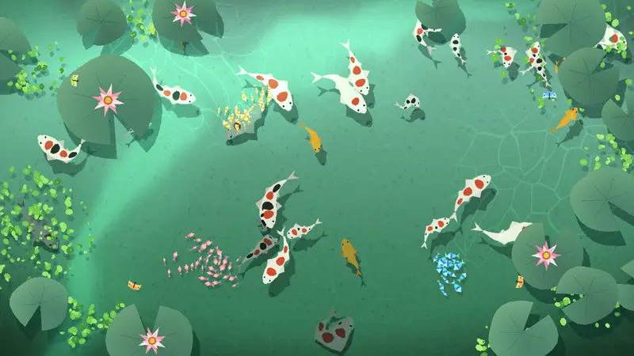

# nagomi-rust

A native Rust port of [nagomi](https://github.com/msk1039/nagomi), the procedural koi pond by [msk1039](https://github.com/msk1039), rendered as a live desktop wallpaper. The pond bed, water currents, ripples, koi, lotus, duckweed, tiny fish, butterflies, and weather presets come from that TypeScript project. This version draws them with wgpu, either into a Wayland background-layer surface on Hyprland or into a window parented under Explorer's desktop on Windows, so there is no browser or WebView involved.

The scene is laid out on the original 480x270 coordinate grid but rendered at the display's native resolution, so shapes come out smooth instead of pixelated. Use `nagomi scale 1-4` to trade quality for GPU/bandwidth: 1 is the original 480x270 pixel-art look, 4 is native 1080p and the default. The setting persists across restarts.

## Demo

[](docs/demo.mp4)

Animated preview at the default settings. Click it for the twelve second 720p clip, `docs/demo.mp4`.

## What you need

| | Linux | Windows |
| --- | --- | --- |
| OS | Wayland compositor with layer shell, developed on Hyprland | Windows 10 or 11 |
| Session | Any Wayland session | A logged-in desktop session with Explorer running |
| GPU | Vulkan or GLES driver | D3D12, falling back to the software WARP adapter |
| Build | Rust 1.85 or newer, pkg-config, libwayland | Rust 1.85 or newer with the MSVC toolchain |

## Linux setup

1. Install the build dependencies. On Arch:

```bash
sudo pacman -S rust pkgconf wayland vulkan-icd-loader mesa
```

On Debian or Ubuntu:

```bash
sudo apt install build-essential pkg-config libwayland-dev libvulkan-dev mesa-vulkan-drivers
```

Rust installed through `rustup` works as well as the distro package. The Vulkan loader and a GPU driver are runtime requirements, not just build ones.

2. Build:

```bash
cargo build --release
```

3. Run it once from a terminal:

```bash
./target/release/nagomi-native
```

The pond should appear behind your windows. If the desktop stays empty, see Troubleshooting.

4. Start it with the session. Save this as `~/.config/systemd/user/nagomi-wallpaper.service`, adjusting the path:

```ini
[Unit]
Description=Native nagomi koi pond wallpaper
PartOf=graphical-session.target
Requires=graphical-session.target
After=graphical-session.target
ConditionEnvironment=WAYLAND_DISPLAY

[Service]
Type=simple
ExecStart=%h/path/to/nagomi-rust/target/release/nagomi-native
Slice=session.slice
Restart=on-failure
RestartSec=2

[Install]
WantedBy=graphical-session.target
```

Then:

```bash
systemctl --user daemon-reload
systemctl --user enable --now nagomi-wallpaper.service
```

Logs go to `journalctl --user -u nagomi-wallpaper`.

5. Put the command on your PATH, so the CLI works from any terminal:

```bash
ln -s "$PWD/target/release/nagomi-native" ~/.local/bin/nagomi
```

## Windows setup

The binary is a single executable with the C runtime linked statically, so it runs on a clean Windows install.

Build on Windows with the MSVC toolchain (Rust from rustup and the Visual Studio Build Tools with the C++ workload):

```powershell
cargo build --release
```

Or cross-compile from Linux with `cargo-xwin`, which needs `clang` and `lld` on the build host:

```bash
rustup target add x86_64-pc-windows-msvc
cargo install cargo-xwin
cargo xwin build --release --target x86_64-pc-windows-msvc
```

The build uses a static CRT through `.cargo/config.toml`, which is why no VC++ redistributable is required. If `lld-link` fails to start with a missing `libLLVM`, install the `lld` package, or point the linker at rustc's bundled copy with a small wrapper that runs `rust-lld -flavor link`.

Run `nagomi-native.exe` with no arguments. It creates a borderless window sized to the primary monitor and reparents it under the WorkerW window Explorer uses for the desktop, which puts the pond behind the icons. This is the same undocumented trick Lively Wallpaper and similar tools use, and an Explorer restart can drop the connection, in which case launch the app again.

Start it with the session:

```powershell
nagomi-native.exe autostart on
```

That writes a per-user entry under `HKCU\Software\Microsoft\Windows\CurrentVersion\Run`. Use `autostart off` to remove it. To run the CLI conveniently, copy or rename the executable to `nagomi.exe` in a folder on your PATH.

## The nagomi command

The command talks to the running wallpaper, over `$XDG_RUNTIME_DIR/nagomi-native.sock` on Linux and loopback TCP port 7391 on Windows.

```
nagomi fish            # show the koi count
nagomi fish 20         # set it, 1 to 48
nagomi weather         # current ambience and the available names
nagomi weather rain    # sunny, deep-clear, overcast, mist, sunset, moonlight, rain
nagomi scale 4         # render resolution, 1 (480x270) to 4 (native)
nagomi leaves 12       # lotus leaves, 0-32
nagomi flowers 3       # lotus flowers, 0-16
nagomi duckweed 5      # duckweed patches, 0-16
nagomi butterflies 2   # butterflies, 0-16
nagomi autostart on    # start with the session (Windows; Linux uses the systemd unit)
nagomi scatter         # startle the koi
nagomi status          # fish, ambience, scale, scene counts, pid, uptime
```

Changes take effect immediately and are remembered across restarts. State lives in `$XDG_STATE_HOME/nagomi/state` on Linux (usually `~/.local/state/nagomi/state`) and `%APPDATA%\nagomi\state` on Windows.

Clicking empty desktop calls the koi to the cursor on Linux. On Windows the desktop belongs to Explorer, so clicks may land on icons instead.

## Troubleshooting

Wallpaper does not start on Linux. The compositor must support layer shell. Check with `hyprctl layers` while it runs; a layer named `nagomi-pond` should be listed. Read the unit log with `journalctl --user -u nagomi-wallpaper`.

`no suitable GPU adapter` in the log. wgpu could not find a Vulkan or GLES device. Install the Vulkan loader and your GPU's driver (Mesa covers Intel and AMD).

Windows: `DXGI_ERROR_NOT_CURRENTLY_AVAILABLE` or a black desktop. The app must run inside a logged-in desktop session, not from a service or a remote session without a desktop. Run it from Explorer or a normal terminal.

Windows: the pond stops updating after the machine sleeps or the VM is paused. The renderer reconfigures its swapchain and recovers on its own; if it stays frozen, restart the app.

Windows: the pond appears as a normal window instead of behind the icons. Explorer was not running when the app started, or its desktop window was recreated. Restart the app after Explorer is up.

High GPU or battery use. Lower the render resolution with `nagomi scale 2`, or reduce the fish count.

Commands report `wallpaper is not running`. The app is not up, or it crashed. Start it first.

## Differences from upstream

The settings UI, ambient river audio, rain sound, butterfly flower visits, and the duckweed ripple push are not ported. Weather is chosen from the CLI instead of a UI panel, and there is no click-to-feed on Windows.

## Uninstall

Linux:

```bash
systemctl --user disable --now nagomi-wallpaper.service
rm ~/.config/systemd/user/nagomi-wallpaper.service
rm ~/.local/bin/nagomi
rm -rf ~/.local/state/nagomi
```

Then delete the checkout.

Windows: run `nagomi autostart off`, close the process, and delete the executable and `%APPDATA%\nagomi`.

## License

This port is distributed under the [PolyForm Noncommercial License 1.0.0](LICENSE), the same license as the [original nagomi](https://github.com/msk1039/nagomi). It is a derivative work of that project, so the license and attribution carry over. Commercial use is not permitted.
