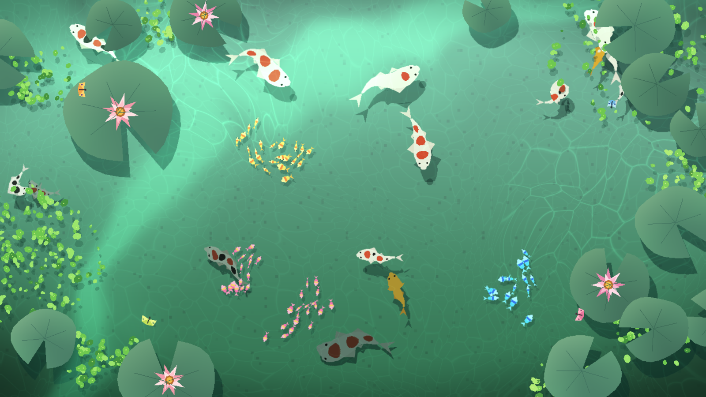
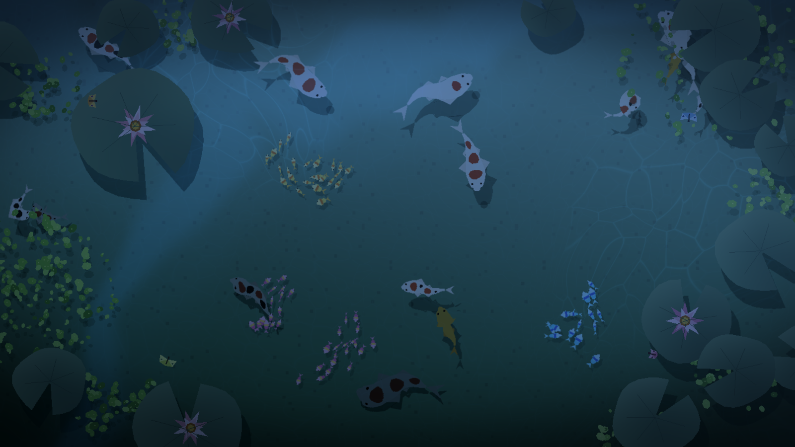
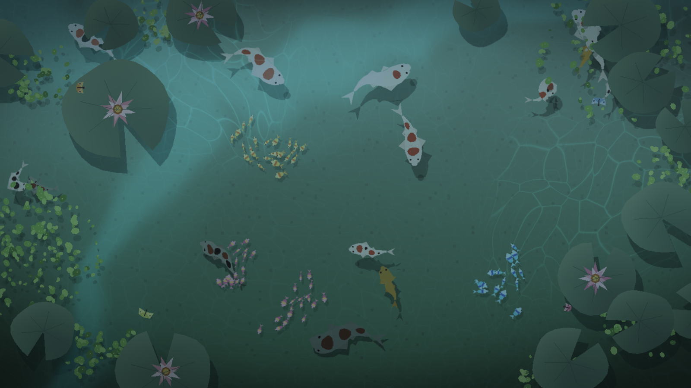

# nagomi-rust

A native Rust port of [nagomi](https://github.com/msk1039/nagomi), the procedural koi pond by [msk1039](https://github.com/msk1039), rendered as a Wayland wallpaper. The pond bed, water currents, ripples, koi, lotus, duckweed, tiny fish, butterflies, and weather presets come from that TypeScript project. This version draws them with wgpu straight into a background-layer surface, so there is no browser or WebView involved.

The scene is laid out on the original 480x270 coordinate grid but rendered at the display's native resolution, so shapes come out smooth instead of pixelated. Use `nagomi scale 1-4` to trade quality for GPU/bandwidth: 1 is the original 480x270 pixel-art look, 4 is native 1080p and the default. The setting persists across restarts.

## Screenshots

| Sunny | Moonlight | Rain |
| --- | --- | --- |
|  |  |  |

All three are rendered at scale 4 (native 1920x1080).

## Requirements

- Linux with Wayland and a layer-shell compositor. Developed on Hyprland.
- A working Vulkan or GLES driver
- Rust toolchain (1.85 or newer)

## Build and run

```bash
cargo build --release
./target/release/nagomi-native
```

Run with no arguments to start the wallpaper. To have it start with the session, use a systemd user unit such as:

```ini
[Unit]
Description=Native nagomi koi pond wallpaper
PartOf=graphical-session.target
Requires=graphical-session.target
After=graphical-session.target
ConditionEnvironment=WAYLAND_DISPLAY

[Service]
Type=simple
ExecStart=%h/Projects/nagomi-rust/target/release/nagomi-native
Restart=on-failure
RestartSec=2

[Install]
WantedBy=graphical-session.target
```

Enable it with `systemctl --user enable --now nagomi-wallpaper.service`.

## Controls

Clicking an empty desktop calls the koi to the cursor. Everything else goes through the command line, which talks to the running wallpaper over a socket in `$XDG_RUNTIME_DIR`:

```
nagomi fish            # show the koi count
nagomi fish 20         # set it, 1 to 48
nagomi weather         # current ambience and the available names
nagomi weather rain    # sunny, deep-clear, overcast, mist, sunset, moonlight, rain
nagomi scale 4         # render resolution, 1 (480x270) to 4 (native)
nagomi scatter         # startle the koi
nagomi status          # fish, ambience, scale, pid, uptime
```

Fish count and ambience are saved to `$XDG_STATE_HOME/nagomi/state` and restored on the next start. The `nagomi` name is just a convenience symlink to the binary.

## Differences from upstream

The settings UI, ambient river audio, rain sound, butterfly flower visits, and the duckweed ripple push are not ported. Weather is chosen from the CLI instead of a UI panel.

## License

This port is distributed under the [PolyForm Noncommercial License 1.0.0](LICENSE), the same license as the [original nagomi](https://github.com/msk1039/nagomi). It is a derivative work of that project, so the license and attribution carry over. Commercial use is not permitted.
